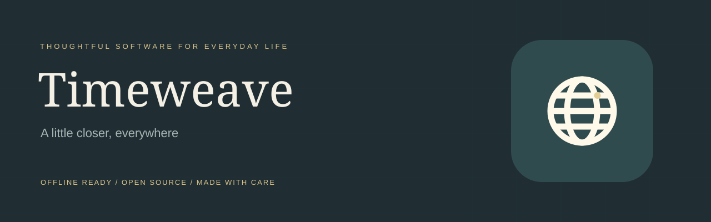
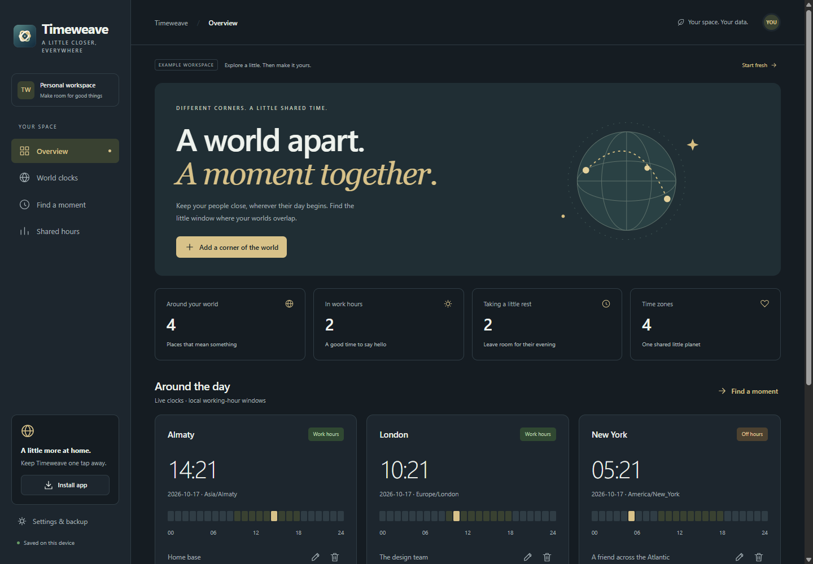
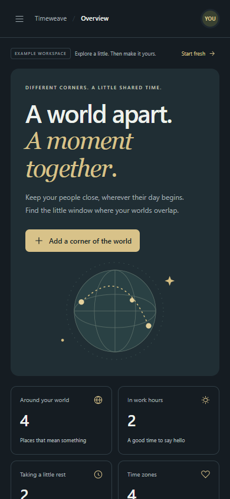

<div align="center">



# Timeweave

**A little closer, everywhere.**

A warm world clock and meeting planner for people in different corners of the day. Time zones, working hours, and shared moments.

[**Open the app →**](https://vertex-blip.github.io/timeweave/) · [Explore the features](#a-little-space-for-what-matters) · [Run locally](#make-it-yours) · [Contribute](CONTRIBUTING.md)

   [](LICENSE)

</div>



## A little space for what matters

- Keep live clocks for 17 curated IANA time zones, including Almaty.
- Compare a UTC meeting time across locations and local dates.
- Account for daylight-saving changes using the browser’s Intl database.
- Find shared whole-hour start times across daytime work windows.
- **Yours from the first click.** Explore the labeled sample workspace or start with an empty one.
- **At home on your phone.** Responsive navigation, original icons, and a standalone PWA window.
- **Ready without a connection.** Works offline after the initial successful online load.
- **Your data stays with you.** Browser-local storage, JSON backup and restore, no account or analytics.

<table><tr><td width="68%">

### Thoughtful by design

A distinct visual identity, generous spacing, crisp typography, and small interactions that serve a purpose. Every illustration and logo is an original SVG asset included in the repository. The custom brandmark uses layered, filled geometry with an install-ready silhouette. See [the identity guide](docs/BRAND.md). No external font or image service is required at runtime.

### Useful, not just a screenshot

The cards and controls are backed by working state. Create, edit, delete, navigate, and pick up where you left off. Use **Settings & backup** to export your workspace, import a backup, restore the sample, or start fresh.

</td><td width="32%"></td></tr></table>

## Make it yours

Requires **Node.js 22+** only for the local server and tests. There are no packages to install and no build step.

```sh
git clone https://github.com/Vertex-blip/timeweave.git
cd timeweave
npm run dev
```

Open **http://127.0.0.1:4173**. Use HTTP rather than opening `index.html` directly: JavaScript modules and service workers need a proper origin.

```sh
npm test
```

The tests cover the product’s data contract, relevant calculations, text escaping, manifest scope, PNG dimensions, and precached files. GitHub Actions runs them on pushes and pull requests.

## Put it on your home screen

1. Open the [live app](https://vertex-blip.github.io/timeweave/) online once.
2. Select **Install app**, or use your browser’s installation menu.
3. On iPhone/iPad, open in Safari and choose **Share → Add to Home Screen**.

The app uses its own logo for 192px, 512px, and maskable installation icons. Installation UI depends on browser support; offline caching and local persistence do not require installing.

## A small, understandable codebase

| File | Purpose |
| --- | --- |
| `product.js` | Product views, actions, schema, and example workspace |
| `app.js` | Navigation, editor, persistence, backup, installation |
| `core.js` / `ui.js` | Pure calculations and escaped UI helpers |
| `styles.css` | Responsive interface and visual identity |
| `manifest.webmanifest` / `sw.js` | Install identity and offline app shell |
| `tests/` | Product behavior and PWA asset checks |

Read [the architecture notes](docs/ARCHITECTURE.md) for data flow and update behavior.

## Publish your own

Fork this repository, enable **GitHub Pages → Deploy from a branch → main / root**, and update the repository links in `README.md`, `index.html`, and `app.js`. All app asset paths are relative, including the PWA scope, so project subpaths are supported. Increment the cache version in `sw.js` when releasing runtime changes.

## Honest boundaries

This is a focused, working **v1.1** for a single person and browser. There is no server, account, synchronization, encryption, or hidden external API. Data in local storage can be cleared by the browser or device, so export backups of important work. Sample records are illustrative. The zone picker is curated; working windows are daytime-only and do not account for weekends or holidays.

## What comes next

Potential improvements, not current features: additional languages, more keyboard shortcuts, and richer import/export formats. Thoughtful contributions are welcome; see [CONTRIBUTING.md](CONTRIBUTING.md).

## License

[MIT](LICENSE) · Built by [Vertex-blip](https://github.com/Vertex-blip).
